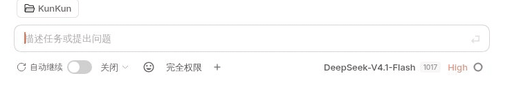

# dsh-until-done · Run until actually done

[**简体中文**](README.md) · [English](README.en.md)


The model says it is finished while the task is half-done — keep it working until it really wraps up.



> A DeepSeek Harness (DSH) plugin for DSH 0.2.0-rc.2 or newer (tested across 0.2.0-rc.2 → 0.2.3).

## What it does

Agents often stop at the end of a turn with work left: tests not run, files not edited, errors not fixed. This plugin hooks `turn/end`: when a turn completes normally but the last assistant reply does not end with the completion keyword, it sends "continue" and pushes the model back to work. Only a reply ending with the keyword (default `完成`) counts as done.

Based on [HsiangNianian/dsh-auto-continue](https://github.com/HsiangNianian/dsh-auto-continue), keeping its recovery, offline suspension and loop guards, with a rewritten completion check and failure classification.

## Features

- **Completion keyword**: keep going unless the last assistant reply ends with it; tool-call messages are skipped and trailing punctuation/quotes/asterisks are tolerated
- **Wrap-up contract in the system prompt**: the rule is injected from the first turn
- **Failure-aware continuations**: tool failures, 429 rate limits and 5xx upstream errors each get their own continuation text; tool failures name the tool and error summary and ask for a root-cause judgement
- **Only continue turns that did work**: plain Q&A (no tools, no active goal) stops, so "hi" is not chased for ten rounds
- **Composer switch**: the "自动继续" chip toggles it without opening settings
- **Retry and recovery**: waits, consecutive caps, backoff, offline suspension, startup recovery, loop guards, browser notifications

## Installation

**Option 1 — plugin marketplace (recommended)**

Search `dsh-until-done` in DSH's plugin marketplace.

**Option 2 — release tarball**

```bash
dsh plugin --profile web add https://github.com/KunKun24/dsh-until-done/releases/download/v1.2.1/dsh-until-done-1.2.1.tgz
```

**Option 3 — local source**

```bash
dsh plugin --profile web add link:/path/to/dsh-until-done
```

Reload the page; the "自动继续" chip appears above the composer.

## Usage

1. Turn on "自动继续" above the composer (or Settings → Plugins → 做完为止)
2. Give the task; the plugin continues when the model stops mid-way
3. The loop ends once the model writes `完成`

## Configuration

Settings live under **More → Plugins → 做完为止**.

| Setting | Default | Meaning |
| --- | --- | --- |
| Require completion keyword | on | Continue when the reply lacks it |
| Completion keyword | `完成` | Pick a word rare in normal prose |
| Inject wrap-up contract | on | Rule present from the first turn |
| Contract text | built-in | `{keyword}` is substituted |
| Only continue turns with actions | off | Plain Q&A stops when enabled |
| Tool-failure / rate-limit / upstream continuation text | built-in | Support `{tool}` `{result}` `{status}` `{code}` |
| Autonomous loop | off | Continue every completed turn until the keyword appears |

## Limits

- It spends tokens: caps and loop guards bound the repeats, but long tasks still cost more
- Detection relies on the keyword; changing it means older replies no longer match
- Independent of `dsh-auto-continue`: both can be installed side by side

## Data & privacy

Settings and run state stay in the local profile data directory. Nothing is uploaded, and no data outside the conversation is read.

## Version & author

- Version **1.2.1** ([changelog](CHANGELOG.md))
- Author: 困困 (KunKun) · GitHub [@KunKun24](https://github.com/KunKun24) · Telegram [@sad1881](https://t.me/sad1881)
- License: [MIT](LICENSE) (derived from HsiangNianian/dsh-auto-continue, original Copyright (c) 2025 HsiangNianian)

Contains AIGC-assisted code, reviewed line by line and verified on a real instance.
