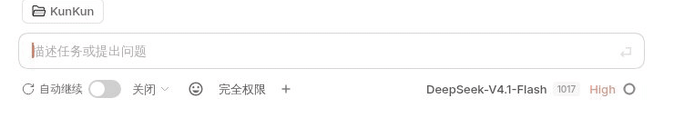

# dsh-until-done · 做完为止

[**简体中文**](README.md) · [English](README.en.md)


模型说“完成了”，但任务才做了一半 —— 让它自己接着干，直到真的收尾。



> DeepSeek Harness（DSH）插件，需要 DSH 0.2.0-rc.2 及以上（0.2.0-rc.2 → 0.2.3 全系列实测可用）。

## 它做什么

智能体常常在一轮结束时停下，留下半截活：测试没跑、文件没改完、报错没修。这个插件接管 `turn/end`，在回合正常结束但**回复末尾没有完成暗号**时，自动发一条「继续」把模型推回工作；写了暗号（默认「完成」）才真正结束。

基于 [HsiangNianian/dsh-auto-continue](https://github.com/HsiangNianian/dsh-auto-continue) 改造，保留其故障恢复、断网挂起、循环护栏，重做了完成判定与失败分类。

## 功能

- **完成暗号**：只要最后一条助手回复不以暗号结尾，就继续；跳过带工具调用的中间消息，容忍尾部标点、引号、星号
- **收尾约定注入系统提示词**：第一轮就告诉模型规则，不用等到第一次续跑
- **失败分类续跑**：工具执行失败、429 限流、5xx 上游错误各有专属续跑文案，工具失败会带上工具名和错误摘要，要求先判断原因、能修就修
- **只续跑真在做事的回合**：开启后普通问答（无工具、无进行中目标）不自动续，避免「你好」被追着回复十轮
- **输入框开关**：底部「自动继续」胶囊一键开关，不用进设置页
- **原有的重试与恢复**：等待时间、连续上限、退避、断网挂起、启动恢复、循环护栏、浏览器通知

## 安装

**方式一：插件市场（推荐）**

在 DSH 的「插件市场」里搜索 `dsh-until-done` 直接安装。

**方式二：Release 包**

```bash
dsh plugin --profile web add https://github.com/KunKun24/dsh-until-done/releases/download/v1.2.1/dsh-until-done-1.2.1.tgz
```

**方式三：本地源码**

```bash
dsh plugin --profile web add link:/path/to/dsh-until-done
```

装完刷新页面，输入框上方出现「自动继续」开关。

## 使用

1. 输入框上方点「自动继续」打开（或 设置 → 插件 → 做完为止）
2. 正常提任务；模型停在中途时插件自动续跑
3. 任务结束时模型写「完成」，循环停止

## 配置

设置入口：左下角 **更多设置 → 插件 → 做完为止**。

| 设置 | 默认 | 说明 |
| --- | --- | --- |
| 要求完成暗号 | 开 | 末尾没有暗号就自动继续 |
| 完成暗号 | `完成` | 建议用正常句子里不常出现的词 |
| 把收尾约定写进系统提示词 | 开 | 第一轮就注入规则 |
| 收尾约定文本 | 内置 | `{keyword}` 替换为暗号 |
| 只续跑有实际动作的回合 | 关 | 开启后普通问答不自动续 |
| 工具失败 / 限流 / 上游错误的继续文本 | 内置 | 支持 `{tool}` `{result}` `{status}` `{code}` |
| 自主循环 | 关 | 开 = 每个正常结束回合都续，直到暗号出现 |

## 限制与注意

- 会自动消耗 token：续跑次数受连续上限与循环护栏约束，但长任务仍可能变贵
- 判定依赖暗号；换暗号后旧任务的回复不会命中
- 与原插件 `dsh-auto-continue` 命名空间完全独立，可以并存

## 数据与隐私

设置与运行状态保存在本机 profile 数据目录，不上传任何内容；不读取对话以外的数据。

## 版本与作者

- 当前版本 **1.2.1**（[更新日志](CHANGELOG.md)）
- 作者：困困 · GitHub [@KunKun24](https://github.com/KunKun24) · Telegram [@sad1881](https://t.me/sad1881)
- 许可证：[MIT](LICENSE)（衍生自 HsiangNianian/dsh-auto-continue，原项目 Copyright (c) 2025 HsiangNianian）

包含 AIGC 辅助编写的内容，已逐行人工审阅并在真机验证。
